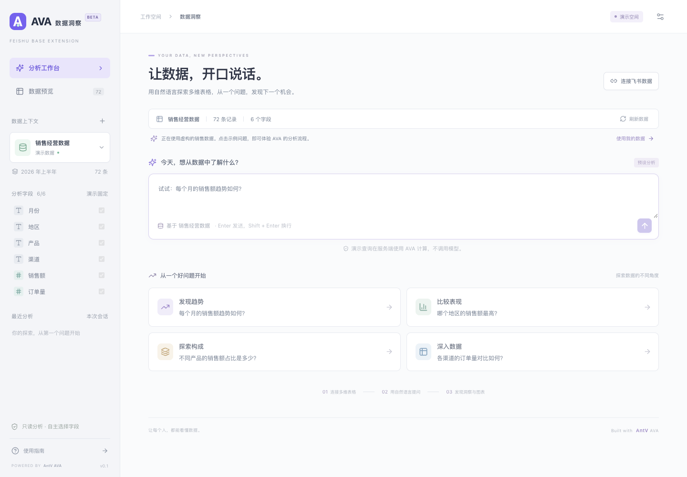
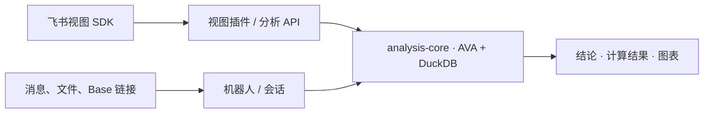

# AVA 飞书扩展

**在表格视图里提问，也能在聊天中分析数据。**

飞书插件与机器人共享 AntV AVA 4 + DuckDB 分析核心，支持中文结论、图表和结果导出，可分别构建、部署。



_图为使用虚构销售数据的独立预览页面。_

## 先体验

需要 **Node.js 22.13+（22.x）和 npm 10+**。本文及子目录指南中的命令均在**仓库根目录**执行。

```sh
nvm use
npm ci
npm run dev:preview
```

打开 [localhost:5173](http://127.0.0.1:5173)，无需密钥即可体验 4 个演示问题。接入真实飞书数据或自由提问，按下面的应用指南配置。

## 选择入口

| 模块                     | 适合做什么                                         | 指南                                             |
| ------------------------ | -------------------------------------------------- | ------------------------------------------------ |
| `apps/base-plugin`       | 在多维表格视图中选择表、视图和字段，查看图表与 SQL | [插件配置与发布](apps/base-plugin/README.md)     |
| `apps/bot`               | 发送文件或 Base 链接，在聊天中分析和追问           | [机器人配置与运行](apps/bot/README.md)           |
| `packages/analysis-core` | 复用 AVA 调用、结果类型、多表装载及关联键检查      | [共享核心开发](packages/analysis-core/README.md) |



两个应用各自管理飞书权限和读表方式。插件按请求分析；机器人保留会话与追问上下文。所选模型服务会接收问题、数据结构及查询结果。

## 开发与验证

```sh
npm run check     # 类型检查
npm run build     # 构建共享核心和两个应用
npm test          # 单元与集成测试
```

浏览器测试在构建后运行：

```sh
npm exec -w @ava/base-plugin -- playwright install chromium
npm run test:e2e
```

端口占用时可用 `PORT=13001 AVA_PREVIEW_PORT=15173 npm run test:e2e`。训练测试需要额外的 Python 依赖，见[机器人指南](apps/bot/README.md#可选本地训练)。

迁移基线：[机器人 6b65984](https://github.com/Keikeikm/ava-feishu-bot/commit/6b65984bf89a47b28dfe580212642f7bcace691a) · [插件 7415bfb](https://github.com/Keikeikm/ava-feishu-plugin/commit/7415bfb91260053143e93bb73f1c677e04d8fa84)。
