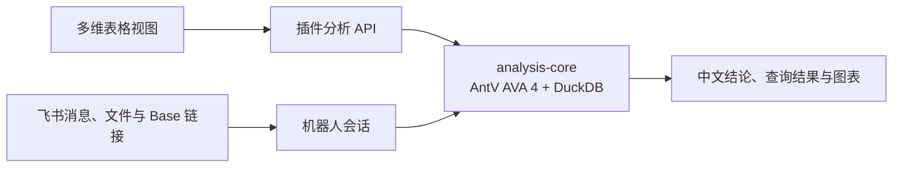

# AVA 飞书扩展

在飞书多维表格或聊天里用中文分析数据。视图插件展示分析过程、图表与 SQL，机器人支持发送文件、导入多维表格和连续追问。两者共用 AntV AVA 4 与 DuckDB，可独立启动和部署。

| 使用场景                         | 模块                     | 从这里开始                                       |
| -------------------------------- | ------------------------ | ------------------------------------------------ |
| 在表格内选字段、提问、查看图表   | `apps/base-plugin`       | [多维表格插件](apps/base-plugin/README.md)       |
| 在飞书聊天里发送文件或 Base 链接 | `apps/bot`               | [飞书机器人](apps/bot/README.md)                 |
| 复用数据装载、关联检查和分析逻辑 | `packages/analysis-core` | [共享分析核心](packages/analysis-core/README.md) |



## 安装依赖

需要 **Node.js 22.13+（22.x）** 和 **npm 10+**。各模块指南中的命令均从仓库根目录执行。

```sh
nvm install
nvm use
npm ci
```

## 体验插件

```sh
npm run dev:preview
```

打开 [本地预览](http://127.0.0.1:5173)。用内置销售数据体验预设问题，无需飞书应用或模型配置。接入真实表格时，按各模块指南配置飞书应用和模型。

## 开发与验证

```sh
npm run check        # 类型检查
npm test             # 单元与集成测试
npm run build        # 构建两个应用与共享核心
```

运行插件浏览器测试前，先执行 `npm run build:plugin` 和 `npm exec -w @ava/base-plugin -- playwright install chromium`，再运行 `npm run test:e2e`。
