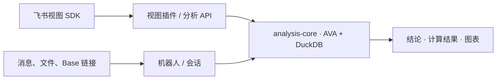

# AVA 飞书扩展

包含飞书聊天机器人和多维表格数据表视图插件，共用 AntV AVA 4 + DuckDB 分析核心，可分别启动、部署。

## 安装依赖

需要 **Node.js 22.13+（22.x）和 npm 10+**。本文及子目录指南中的命令均在**仓库根目录**执行。

```sh
nvm use
npm ci
```

每次新开终端后，先执行 `nvm use`；`.nvmrc` 本身不会自动切换 Node 版本。

## 启动机器人

1. 在[飞书开放平台](https://open.feishu.cn/app)创建企业自建应用，添加「机器人」能力，取得 **App ID、App Secret**。
2. 导入[机器人权限配置](apps/bot/docs/feishu-permissions.json)，或按[机器人指南](apps/bot/README.md#1-配置飞书应用)开通私聊所需权限。
3. 创建本地配置文件：

```sh
cp apps/bot/.env.example apps/bot/.env
```

编辑 `apps/bot/.env`，填写飞书凭证和支持 Chat Completions 的模型配置：

```dotenv
FEISHU_APP_ID=你的AppID
FEISHU_APP_SECRET=你的AppSecret
LLM_API_KEY=你的模型密钥
LLM_MODEL=模型名称
LLM_BASE_URL=供应商接口根地址
```

然后构建并启动机器人：

```sh
npm run build:bot
npm start -w @ava/bot
```

保持进程运行，在飞书「事件与回调」中选择长连接，订阅 `im.message.receive_v1`，再发布应用。随后在飞书中打开机器人私聊，发送表格文件并提问。

Base 链接、群聊权限、Docker 部署和训练配置见[机器人指南](apps/bot/README.md)。

## 启动多维表格插件

1. 在[飞书开放平台](https://open.feishu.cn/app)创建应用，添加「多维表格插件 → 数据表视图」能力，取得 **App ID、BlockTypeID**，并准备一张用于调试的多维表格。
2. 创建本地配置文件：

```sh
cp apps/base-plugin/.env.example apps/base-plugin/.env
```

编辑 `apps/base-plugin/.env`，填写 `AVA_API_KEY`、`AVA_MODEL`；使用自定义模型服务时，还需按供应商要求设置 `AVA_BASE_URL`。本地调试的服务令牌和来源白名单由启动脚本自动管理。

将下面命令中的 App ID、BlockTypeID 和表格链接替换为自己的值，然后绑定应用、登录并启动：

```sh
npm run plugin:configure -w @ava/base-plugin -- \
  --app-id cli_你的AppID \
  --block-type-id blk_你的BlockTypeID \
  --base-url 'https://你的租户.feishu.cn/base/你的表格token' \
  --api-origin http://127.0.0.1:3001

npm exec -w @ava/base-plugin -- opdev login
npm run dev:plugin
```

启动命令同时运行分析 API 和插件调试服务，自动选择可用端口，并打开飞书调试表。保持进程运行，在表格中通过「＋ → 更多插件」添加已配置的插件视图，选择数据范围和字段后提问。

连接异常时，在另一个终端运行：

```sh
npm run doctor:plugin
```

正式部署分析 API、上传视图包和发布应用见[插件指南](apps/base-plugin/README.md#4-部署与发布)。

## 项目结构

| 模块                     | 适合做什么                                         | 指南                                             |
| ------------------------ | -------------------------------------------------- | ------------------------------------------------ |
| `apps/base-plugin`       | 在多维表格视图中选择表、视图和字段，查看图表与 SQL | [插件配置与发布](apps/base-plugin/README.md)     |
| `apps/bot`               | 发送文件或 Base 链接，在聊天中分析和追问           | [机器人配置与运行](apps/bot/README.md)           |
| `packages/analysis-core` | 复用 AVA 调用、结果类型、多表装载及关联键检查      | [共享核心开发](packages/analysis-core/README.md) |



两个应用各自管理飞书权限和读表方式。插件按请求分析；机器人保留会话与追问上下文。所选模型服务会接收问题、数据结构及查询结果。

## 开发与验证

```sh
npm run check     # 类型检查
npm run build     # 构建共享核心和两个应用
npm test          # 单元与集成测试
```

浏览器测试在构建后运行：

```sh
npm exec -w @ava/base-plugin -- playwright install chromium
npm run test:e2e
```

端口占用时可用 `PORT=13001 AVA_PREVIEW_PORT=15173 npm run test:e2e`。训练测试需要额外的 Python 依赖，见[机器人指南](apps/bot/README.md#可选本地训练)。

迁移基线：[机器人 6b65984](https://github.com/Keikeikm/ava-feishu-bot/commit/6b65984bf89a47b28dfe580212642f7bcace691a) · [插件 7415bfb](https://github.com/Keikeikm/ava-feishu-plugin/commit/7415bfb91260053143e93bb73f1c677e04d8fa84)。
