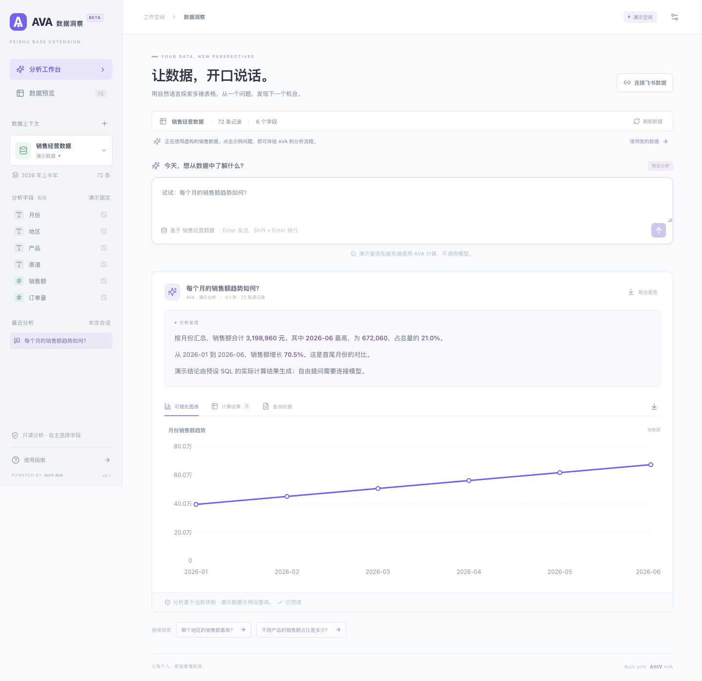

[项目首页](../../README.md) / 多维表格插件

# AVA 数据洞察

在飞书多维表格中选择数据范围和字段，用中文提问。左侧实时显示分析过程，右侧展示摘要、查询结果、SQL 与 AntV 图表，可导出 CSV 和 Markdown 报告。



_界面示例使用测试数据。_

## 本地调试

先完成[依赖安装](../../README.md#安装依赖)。以下命令均在仓库根目录执行。

1. 创建配置文件，在 `apps/base-plugin/.env` 填写 `AVA_API_KEY` 和 `AVA_MODEL`。使用自定义模型服务时，按供应商要求填写 `AVA_BASE_URL`。

   ```sh
   cp -n apps/base-plugin/.env.example apps/base-plugin/.env
   ```

2. 创建飞书自建应用，添加 **「多维表格插件 → 数据表视图」**，取得 App ID 和该能力的 BlockTypeID。将命令中的示例 ID 与 Base 链接替换成自己的值。 [飞书开发者后台](https://open.feishu.cn/app) · [数据表视图开发指南](https://open.feishu.cn/document/base-extensions/base-table-view-extension-development-guide)

   ```sh
   npm run plugin:configure -w @ava/base-plugin -- \
     --app-id cli_YourAppId \
     --block-type-id blk_YourTableViewId \
     --base-url 'https://example.feishu.cn/base/YourBaseToken'

   npm exec -w @ava/base-plugin -- opdev login
   npm run dev:plugin
   ```

3. 打开终端打印的调试链接，在表格顶部点 **「+ → 添加更多插件」**，添加 AVA。启动脚本会自动选择空闲端口、加入 `debugPort` 并处理调试认证。

换一份表调试时，运行 `npm run doctor:plugin -- --url '<表格链接>'` 获取对应链接。加 `--stream` 可用内置数据检查模型的流式输出。

## 从普通表格链接添加

发布后，飞书托管视图页面，页面通过 HTTPS 调用分析 API。如果 API 仍在你的 Mac 上运行，ngrok 可以提供一个固定的公网 HTTPS 地址，把请求转发到本机端口。

**飞书视图** → **ngrok 公网 HTTPS 地址** → **Mac 上的分析 API**

已有可访问的 HTTPS 分析 API 时，直接使用该地址并跳过第 2 步。仅用 `debugPort` 本地调试时，也可以跳过本节。

1. **启动分析 API。** 在 `apps/base-plugin/.env` 设置 `PLUGIN_ACCESS_TOKEN`，可用 `openssl rand -hex 32` 生成。在 `PLUGIN_ALLOWED_ORIGINS` 填写插件页面的实际来源，例如 `https://blk_YourTableViewId.feishupkg.com`。本机运行时使用 `HOST=127.0.0.1`。

   ```sh
   npm run build:core
   npm start -w @ava/base-plugin
   ```

2. **为本机 API 启动 ngrok 隧道。** 首次使用时，安装 ngrok 并配置 ngrok 账号的 Authtoken。 [ngrok 安装与配置](https://ngrok.com/docs/start)

   另开一个终端运行下方命令。`3001` 是默认 API 端口，以第 1 步的启动日志为准。

   ```sh
   ngrok http http://127.0.0.1:3001 --inspect=false
   ```

   复制 ngrok 终端 `Forwarding` 一栏里的 HTTPS 地址，下一步会用到。使用插件时，保持分析 API 和 ngrok 隧道都在运行。 [ngrok 固定域名说明](https://ngrok.com/docs/gateway/domains)

3. **绑定 HTTPS 地址并上传视图包。** 将命令里的示例换成上一步拿到的地址，或已有的 HTTPS 分析 API 地址，只填协议和主机名。把同一地址填入飞书后台的「服务器域名白名单」。

   ```sh
   npm run plugin:configure -w @ava/base-plugin -- --api-origin https://ava.example.com
   npm run plugin:upload -w @ava/base-plugin
   ```

4. **发布并添加视图。** 在「多维表格数据表视图」选择上传的组件版本并保存，再到「版本管理与发布」提交应用版本。仅自己使用时，可用范围只选本人。发布后用普通链接打开可编辑的表格，通过「+ → 添加更多插件」添加 AVA。 [飞书数据表视图发布指南](https://open.feishu.cn/document/base-extensions/base-table-view-extension-development-guide)

5. **连接一次。** 在「连接设置」输入服务访问令牌，勾选「在此浏览器记住令牌」，再应用设置。此后同一浏览器、同一飞书账号可在其他表格自动连接。取消勾选并应用设置可清除保存的令牌。

如果菜单没有 AVA，检查已发布的应用版本是否包含**数据表视图**能力，以及当前账号是否在可用范围内。若视图能打开但连不上分析服务，检查 HTTPS 地址、飞书的服务器域名白名单及 API 的 `PLUGIN_ALLOWED_ORIGINS`。

## 分析数据

1. 在「数据范围」选择主表和源视图，在「选择字段」勾选要分析的列。
2. 需要跨表时，点「添加关联表」并指定关联键。两侧字段类型须一致，关联表的键须唯一。AVA 会检查匹配率。
3. 提问，例如「按客户地区汇总订单金额」。在结果栏查看图表、数据和 SQL，按需导出。原表有更新时点「刷新数据」。每次提问独立分析，请写明完整问题。

草稿和最近 10 次分析按飞书账号、Base、插件视图和数据表保存在当前浏览器。切换页面后，可以回来查看历史或取回后台任务结果。已完成的任务最多保留 1 小时，分析服务重启后，未取回的任务需重新提交。

所选表合计最多 10,000 条记录，每表最多 80 个字段，请求上限 8 MB，计算结果最多返回 1,000 行。只提交所选字段，模型服务可能接收问题、数据结构、统计信息和查询结果。

## Docker 部署分析 API

```sh
docker build -f apps/base-plugin/Dockerfile -t ava-base-plugin .
docker run --rm --env-file apps/base-plugin/.env \
  -e HOST=0.0.0.0 -p 127.0.0.1:3001:3001 ava-base-plugin
```

如果在前面接反向代理，配置 HTTPS、允许 8 MB 请求体和至少 150 秒的连接时限，并关闭 `/api/analysis-jobs/*/events` 的响应缓冲和缓存。
