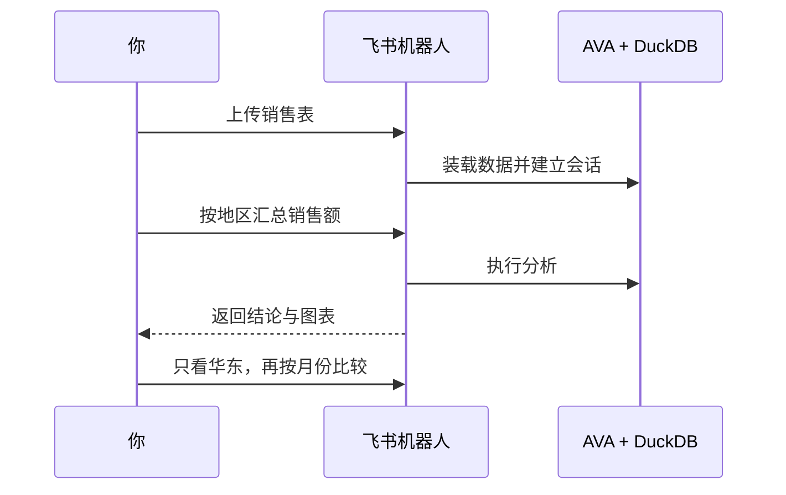

[项目首页](../../README.md) / 飞书机器人

# AVA 飞书机器人

发送文件或多维表格链接，用中文提问、查看图表并继续追问。机器人通过飞书长连接收消息，可在本机运行，无需配置公网回调地址。



## 启动私聊机器人

先完成[依赖安装](../../README.md#安装依赖)。以下命令均在仓库根目录执行。

1. 创建飞书企业自建应用，添加「机器人」能力，获取 App ID 和 App Secret。私聊用到 `im:message.p2p_msg:readonly`、`im:message:readonly`、`im:message:send_as_bot` 和 `im:resource`。 [飞书开发者后台](https://open.feishu.cn/app) · [可导入的权限 JSON，含群聊权限](docs/feishu-permissions.json)
2. 复制配置模板，在 `apps/bot/.env` 填写 `FEISHU_APP_ID`、`FEISHU_APP_SECRET`、`LLM_API_KEY` 和 `LLM_MODEL`。按模型供应商设置 `LLM_BASE_URL`，模型需支持 Chat Completions。

   ```sh
   cp -n apps/bot/.env.example apps/bot/.env
   ```

3. 配置完成后，在终端构建并启动机器人。

   ```sh
   npm run build:bot
   npm start -w @ava/bot
   ```

4. 保持机器人运行，在飞书后台「事件与回调」选择长连接，订阅 `im.message.receive_v1`，并发布应用。然后打开机器人私聊，发送示例文件，再问「按地区汇总销售额」。 [销售示例 CSV](examples/sales.csv)

## 在聊天中使用

| 想做什么       | 发送内容                                                        |
| -------------- | --------------------------------------------------------------- |
| 分析与追问     | `按地区汇总销售额，并画柱状图`，接着问 `只看华东，再按月份比较` |
| 查看当前数据   | `/状态`、`/字段`、`/预览`、`/画像`                              |
| 查看建议       | `/建议`                                                         |
| 导出上次结果   | `/导出 CSV`、`/导出 JSON`、`/导出 图表`                         |
| 清除数据与会话 | `/清空`                                                         |

支持 CSV、TSV、XLSX、JSON、JSONL、NDJSON、Parquet、SQLite、TXT、Markdown 和 ZIP。旧 `.xls` 请先转为 `.xlsx` 或 CSV。ZIP 解包需要 Python 3，可用 `/选文件 1` 选择其中的文件。

**导入多维表格。** 为应用开通 `bitable:app:readonly`，并授予该应用目标文档的访问权限。发送原始 Base 链接即可导入，带 `table=tbl…` 时只导入指定数据表。知识库 `/wiki/` 链接还需要 `wiki:wiki:readonly` 和对应知识空间的访问权限。

**在群里使用。** 把机器人加入群，开通 `im:message.group_at_msg:readonly`，将 `GET /open-apis/bot/v3/info` 返回的机器人 `open_id` 填入 `FEISHU_BOT_OPEN_ID`，然后通过 `@` 提问。收取群文件还需要 `im:message.group_msg`。修改权限后发布应用版本。

## 部署与会话

```sh
docker compose -f apps/bot/compose.yaml up -d --build
docker compose -f apps/bot/compose.yaml logs -f bot
```

机器人以单实例运行。默认上传上限 20 MB，会话保留 60 分钟，重启后需重新导入数据。Excel、SQLite 和多表 Base 首次读取可能需要下载 DuckDB 扩展。

模型服务会接收问题、数据结构和查询结果，文本分析还可能发送原文。可用 `ALLOWED_USER_IDS` 限制使用者，用 `LOG_USER_INPUT=false` 关闭用户消息正文日志。 [完整环境变量](.env.example)

## 可选的本地训练

分类、回归训练需 Python 3.11+。Docker 镜像已包含所需依赖，本机运行时可安装到项目虚拟环境。

```sh
python3 -m venv apps/bot/.venv
apps/bot/.venv/bin/python -m pip install -r apps/bot/ml/requirements.txt
```

上传含目标列的数据后，发送 `/训练 <目标列>`。预测连续数值时加 `--回归`。
