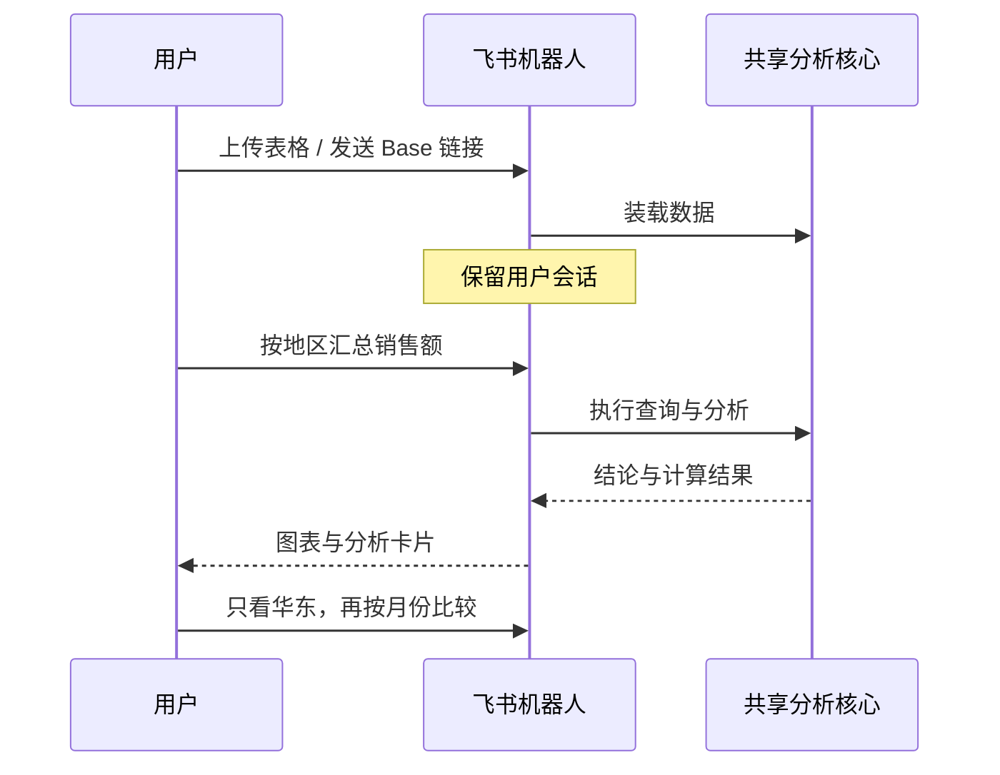

[项目首页](../../README.md) / 飞书机器人

# 在聊天中分析表格

发送文件或多维表格链接，获取中文结论与图表，再围绕同一份数据追问。通过飞书长连接接收消息，无需公网回调地址。



## 1. 配置飞书应用

在[飞书开放平台](https://open.feishu.cn/app)创建企业自建应用并添加「机器人」能力，保存 **App ID 和 App Secret**。

私聊需要以下应用身份权限；也可使用[权限导入 JSON](docs/feishu-permissions.json)配置：

| 权限                          | 用途         |
| ----------------------------- | ------------ |
| `im:message.p2p_msg:readonly` | 接收私聊消息 |
| `im:message:readonly`         | 下载消息附件 |
| `im:message:send_as_bot`      | 回复消息     |
| `im:resource`                 | 上传导出文件 |

## 2. 配置并启动

先完成[依赖安装](../../README.md#安装依赖)。**以下命令均在仓库根目录执行。**

```sh
cp apps/bot/.env.example apps/bot/.env
```

编辑 `apps/bot/.env`，填写飞书凭证和兼容 Chat Completions 的模型配置：

```dotenv
FEISHU_APP_ID=你的AppID
FEISHU_APP_SECRET=你的AppSecret
LLM_API_KEY=你的模型密钥
LLM_MODEL=模型名称
LLM_BASE_URL=供应商接口根地址
```

```sh
npm run build:bot
npm start -w @ava/bot
```

保持进程运行，在飞书「事件与回调」中选择长连接，订阅 `im.message.receive_v1`，再发布应用。向机器人发送 [sales.csv](examples/sales.csv)，提问「按地区汇总销售额」即可验证。

## 3. 在聊天中使用

| 想做什么         | 发送内容                                    |
| ---------------- | ------------------------------------------- |
| 整体分析或画图   | `分析一下` / `按地区汇总销售额，并画柱状图` |
| 继续追问         | `只看华东，再按月份比较`                    |
| 查看当前数据     | `/状态`、`/字段`、`/预览`、`/画像`          |
| 获取问题建议     | `/建议`                                     |
| 导出上次结果     | `/导出 CSV`、`/导出 JSON`、`/导出 图表`     |
| 清除数据与上下文 | `/清空`                                     |

支持 CSV、TSV、JSON、JSONL、XLSX、Parquet、SQLite、TXT、Markdown 和 ZIP。旧 `.xls` 需先转换；文本抽取上限为 256 KB；ZIP 需 Python 3，可用 `/选文件 <编号>` 选择内部文件。

**导入 Base**：开通 `bitable:app:readonly`，并在表格中为同一应用授予文档访问权限，然后发送原始 `/base/` 链接。整份 Base 会加载所有子表，带 `table=tbl…` 时只加载指定表；跨表提问应说明表名、关联键和统计口径。`/wiki/` 链接还需 `wiki:wiki:readonly` 及知识空间访问权限。

读表失败时，可用[飞书 CLI 诊断与授权](../../scripts/feishu/README.md)核对应用身份、预览 Base 授权并复查。

**群聊**：加入群并开通 `im:message.group_at_msg:readonly`，通过 `GET /open-apis/bot/v3/info` 获取机器人的 `open_id`，填入 `FEISHU_BOT_OPEN_ID`，再通过 `@` 提问。接收群文件还需 `im:message.group_msg`。修改权限后需重新发布应用。

## 4. 部署与运行

配置好 `apps/bot/.env` 后，可用 Compose 启动：

```sh
docker compose -f apps/bot/compose.yaml up -d --build
docker compose -f apps/bot/compose.yaml logs -f bot
```

保持单实例运行。默认文件上限 **20 MB**、会话有效期 **60 分钟**；完整配置见 [.env.example](.env.example)。会话保存在进程内，重启后需重新导入。Excel、SQLite 和多表 Base 首次加载可能下载 DuckDB 扩展，需要联网且用户主目录可写。

模型会接收问题、数据结构、计算结果与追问上下文，文本抽取也会发送原文。`LOG_USER_INPUT=false` 可关闭日志中的用户消息正文，`ALLOWED_USER_IDS` 可限制使用者。

## 可选：本地训练

分类、回归训练需 Python 3.11+；Dockerfile 已包含依赖安装步骤。

```sh
python3 -m venv apps/bot/.venv
apps/bot/.venv/bin/python -m pip install -r apps/bot/ml/requirements.txt
```

上传带目标列的数据后，发送 `/训练 <目标列>`；回归任务加 `--回归`。这组依赖也用于运行训练测试。
