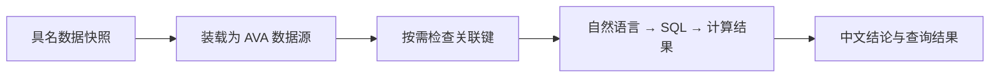

[项目首页](../../README.md) / 共享分析核心

# @ava/analysis-core

插件与机器人共用的服务端分析包。接收已读取的数据，复用 AVA 配置、分析约束、结果类型和多表装载。



## 公开接口

| 接口                                           | 职责                                                                  |
| ---------------------------------------------- | --------------------------------------------------------------------- |
| `createAnalysisEngine(llm, limits)`            | 创建 DuckDB 引擎，统一内存与线程配置                                  |
| `analyzeQuestion(ava, prompt, options)`        | 执行分析，加入中文、真实计算和统计口径约束                            |
| `loadJsonSnapshots(ava, directory, snapshots)` | 装载 `{ name, rows }` 快照；多表汇入 SQLite                           |
| `loadSqliteTables(ava, path, sources)`         | 将多个单表读取器汇入同一个 SQLite 快照                                |
| `inspectJoin(ava, primary, related)`           | 两侧传入 `{ table, field }`，返回匹配行数、空键数、重复键数和关联条件 |

同时导出 `AnalysisResponse`、`ChartSpec`、`VisualizeResponse`、`LLMConfig` 等类型。

## 调用约定

- **应用负责权限与会话**：选择能读取的表和字段，提供模型配置、私有临时目录，并在结束后调用 `ava.dispose()`、清理目录。
- **使用返回的表名**：单表 JSON 快照名为 `data`；多表使用各自名称，同名表会自动加后缀。
- **按业务处理检查结果**：`inspectJoin` 返回诊断，不自动拒绝分析。插件服务会拦截关联表重复键及零匹配；空白键不匹配，文本 `001` 与 `1` 保持不同。

可从两个真实调用入口开始阅读：[插件分析服务](../../apps/base-plugin/server/analysis.ts) · [机器人分析 worker](../../apps/bot/src/analysis-worker.ts)。

## 开发

完成[根目录安装](../../README.md#先体验)后，在仓库根目录执行：

```sh
npm run build:core
npm test -w @ava/analysis-core
```
